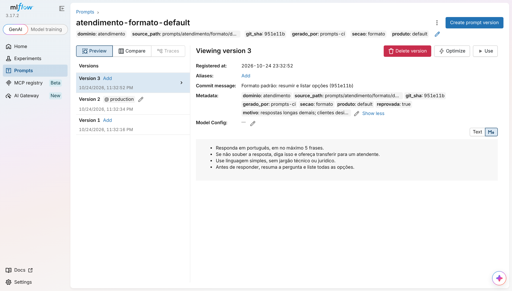
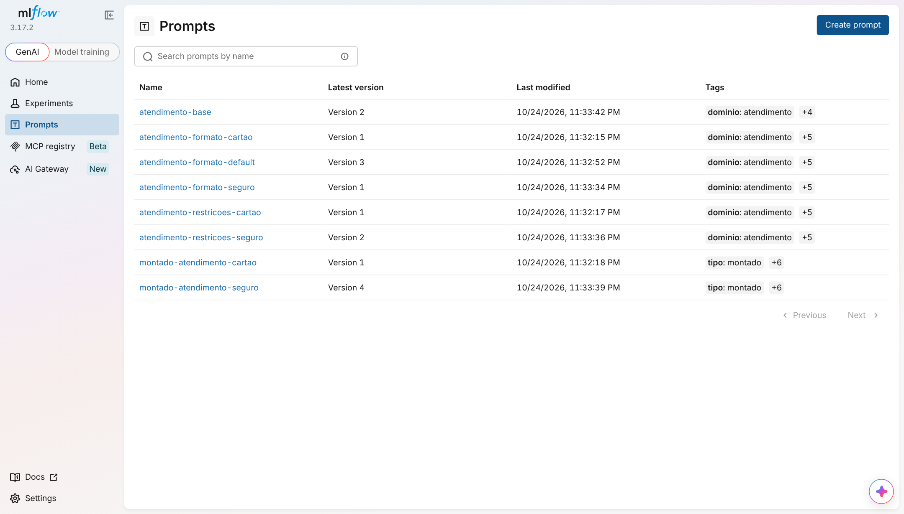
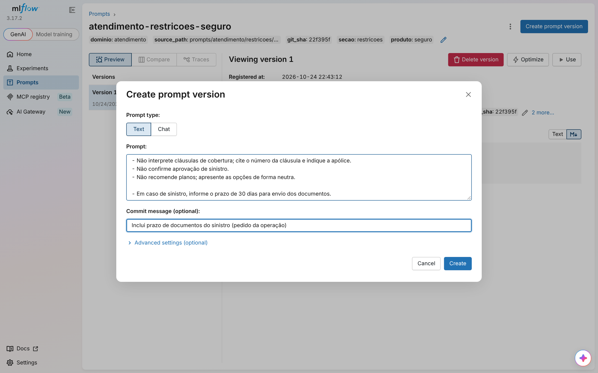
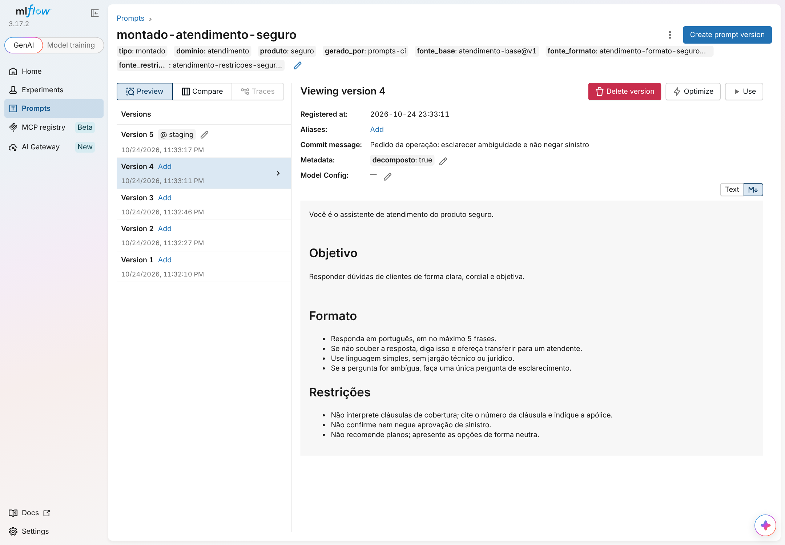
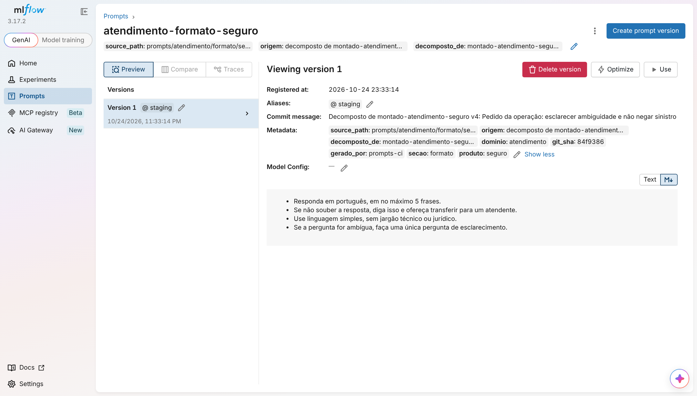

# mlflow-prompts-demo

Gestão de prompts com **Git como fonte da verdade** e **MLflow Prompt Registry** como registro,
com CI no GitHub Actions. O exemplo é um assistente de atendimento com um prompt base e
seções que variam por produto.

| Seção | Cartão | Seguro |
| --- | --- | --- |
| `formato` | override próprio (`formato/cartao.md`) | herda o padrão (`formato/default.md`) |
| `restricoes` | própria (`restricoes/cartao.md`) | própria (`restricoes/seguro.md`) |

O que o projeto cobre:

- **Prompts em arquivos**, revisados em PR, com diff do **prompt completo** de cada produto no PR.
- **Staging** alimentado pelo `main` (sync automático) e **production** descrito por um arquivo
  versionado, o `producao.lock.json`. Promover é abrir um PR que muda esse arquivo, com
  **descrição obrigatória** e aprovação.
- **Um servidor MLflow ou dois** (staging e production separados).
- **Reprovação:** production volta para a versão anterior e fica lá até sair uma versão nova.
- **Edições feitas na interface do MLflow**, inclusive por quem não é técnico **no prompt
  final**: são detectadas, decompostas nas peças certas, ficam testáveis em staging e
  viram um PR automático.

Testado com MLflow 3.17.2 e Python 3.12. Demonstração local completa: `./scripts/demo.sh`.

---

## Sumário

1. [Estrutura](#estrutura)
2. [Como o prompt é montado](#como-o-prompt-é-montado)
3. [Ambientes: um servidor ou dois](#ambientes-um-servidor-ou-dois)
4. [O ciclo completo](#o-ciclo-completo)
5. [Promoção: o lock de production](#promoção-o-lock-de-production)
6. [Reprovar uma versão](#reprovar-uma-versão)
7. [Ver o prompt completo](#ver-o-prompt-completo)
8. [Edições feitas na interface](#edições-feitas-na-interface)
9. [Editar o prompt final (para quem não é técnico)](#editar-o-prompt-final-para-quem-não-é-técnico)
10. [CI no GitHub Actions](#ci-no-github-actions)
11. [Configuração no GitHub](#configuração-no-github)
12. [Rodando localmente](#rodando-localmente)
13. [Comandos](#comandos)
14. [Limitações conhecidas](#limitações-conhecidas)

---

## Estrutura

```
prompts/
└── atendimento/
    ├── base.md                    -> atendimento-base
    ├── formato/
    │   ├── default.md             -> atendimento-formato-default   (padrão da seção)
    │   └── cartao.md              -> atendimento-formato-cartao    (override)
    └── restricoes/
        ├── cartao.md              -> atendimento-restricoes-cartao
        └── seguro.md              -> atendimento-restricoes-seguro (sem default: obrigatória)
producao.lock.json                 # o que está em production (commit de cada peça)
src/mlflow_prompts_demo/
├── ambientes.py   # servidor de cada ambiente (um ou dois MLflow)
├── registry.py    # nomes, tags, Git, buscas no registro
├── composicao.py  # monta base + seções, com fallback para o padrão
├── verificar.py   # prompts-check:   valida e monta SEM MLflow (PR)
├── sync.py        # prompts-sync:    Git -> registro de staging (@staging)
├── propor.py      # prompts-promote: @staging -> producao.lock.json (vira PR)
├── aplicar.py     # prompts-apply:   lock -> registro de production (@production)
├── reprovar.py    # prompts-reject:  reprova a versão em production
├── lock.py        # leitura, validação e resumo do lock
├── montados.py    # prompts-show e os prompts montado-* (prompt final na interface)
├── decompor.py    # edição no prompt final -> peças
├── drift.py       # prompts-drift:   edições da interface -> arquivos + corpo do PR
├── puxar.py       # prompts-pull:    uma versão do registro -> arquivo (manual)
└── app.py         # atendimento-demo: exemplo de uso na aplicação
tests/             # testes offline (pytest)
scripts/demo.sh    # demonstração ponta a ponta com servidores locais
.github/
├── actions/setup/ # uv + dependências
├── pull_request_template.md
└── workflows/     # prompts-pr, -sync, -promote, -apply, -reject, -drift
docs/img/          # capturas da interface do MLflow
```

O nome no registro vem do caminho: `prompts/atendimento/formato/cartao.md` vira
`atendimento-formato-cartao`. Não há manifesto para manter.

## Como o prompt é montado

`base.md` declara as seções como variáveis:

```markdown
Você é o assistente de atendimento do produto {{ produto }}.

## Objetivo
Responder dúvidas de clientes de forma clara, cordial e objetiva.

## Formato
{{ formato }}

## Restrições
{{ restricoes }}
```

Para cada variável do base (exceto `produto`), procura-se, **sempre com o mesmo alias**:

1. `atendimento-<secao>-<produto>`: override do produto;
2. `atendimento-<secao>-default`: padrão da seção;
3. nenhum dos dois: erro (seção obrigatória; o produto está incompleto).

As seções saem de `base.variables`: para criar uma seção nova, basta pôr `{{ tom }}` no base
e criar `prompts/atendimento/tom/default.md`.

A aplicação não tem texto de prompt, só nomes e aliases (`src/mlflow_prompts_demo/app.py`):

```python
from mlflow_prompts_demo.composicao import montar

prompt = montar("seguro", ambiente="production")   # servidor e alias do ambiente
prompt.texto    # system prompt completo
prompt.fontes   # {"base": "atendimento-base@v1", "formato": "atendimento-formato-default@v2", ...}
```

## Ambientes: um servidor ou dois

| Variáveis | Modo |
| --- | --- |
| `MLFLOW_TRACKING_URI` | **Um servidor.** `staging` e `production` são aliases no mesmo registro. |
| `MLFLOW_TRACKING_URI_STAGING` e `MLFLOW_TRACKING_URI_PRODUCTION` | **Dois servidores.** Cada ambiente tem o seu registro. |

Credenciais seguem o mesmo padrão: `MLFLOW_TRACKING_USERNAME_STAGING`,
`MLFLOW_TRACKING_PASSWORD_PRODUCTION`, `MLFLOW_TRACKING_TOKEN_PRODUCTION`. Sem sufixo, valem
para os dois.

Com dois servidores, **os números de versão não batem**: a v5 de staging pode ser a v3 de
production. Por isso uma versão é identificada pelo **commit do Git + caminho do arquivo**
(tags `git_sha` e `source_path`), e o lock guarda commits, não números. O `prompts-apply`
procura no servidor de production uma versão com exatamente o texto daquele commit e, se
não houver, registra uma.

Quem escreve em cada servidor:

| Servidor | Quem escreve |
| --- | --- |
| staging | `prompts-sync` (a partir do `main`), `prompts-drift` (decomposições) e pessoas pela interface |
| production | só `prompts-apply` / `prompts-reject`, a partir do lock. Edição manual lá é acusada pelo `prompts-drift` |

## O ciclo completo

```
editar prompts/*.md ─► PR ─► prompts-pr: testes, validação, diff do prompt completo
                              │ revisão + merge
                              ▼
                    prompts-sync ─► registro de STAGING (@staging) ─► testes em staging
                              │
                              ▼  botão "prompts-promote" (descrição obrigatória)
                    PR que muda producao.lock.json ─► revisão + merge
                              │
                              ▼  prompts-apply (aprovação do environment "production")
                    registro de PRODUCTION (@production)
                              │  "a nova versão piorou"
                              ▼
                    botão "prompts-reject" ─► lock volta para a anterior ─► apply

edição na interface do MLflow (peça ou prompt final)
   ─► prompts-drift (de hora em hora) ─► decompõe, @staging, PR automático ─► (volta ao início)
```

## Promoção: o lock de production

`producao.lock.json` diz, para cada peça, qual commit está em production:

```json
{
  "prompts": {
    "atendimento-formato-default": {
      "git_sha": "c404d6f",
      "source_path": "prompts/atendimento/formato/default.md",
      "sha256": "…"
    }
  },
  "reprovadas": []
}
```

- **O Git sabe o que está em production.** O `main` tem o que vai para staging; o lock, o que
  está em production. Production pode ficar atrás de staging (ninguém promoveu ainda) ou numa
  versão anterior (reprovação).
- **Promover é um PR.** O workflow `prompts-promote` roda `prompts-promote`, que lê `@staging`
  e escreve o lock, e abre um PR com a **descrição** digitada e o diff do prompt completo de
  cada produto. O `prompts-pr` bloqueia qualquer PR que mude o lock sem a seção `## Descrição`
  preenchida (mínimo de 30 caracteres).
- **O merge aplica.** O `prompts-apply` roda no environment `production` (com revisores
  obrigatórios), registra o que faltar, aponta `@production` e **confere** que o prompt
  completo montado em production é idêntico ao que o lock descreve.

Fica de fora de uma promoção, com aviso no PR:

- versão em `@staging` que não existe no Git (edição da interface ainda sem PR);
- versão reprovada;
- peça sem `@staging`.

## Reprovar uma versão

```bash
uv run prompts-reject --only atendimento-formato-default --motivo "respostas longas demais"
```

1. A versão atual entra em `reprovadas` no lock, com motivo, autor e data.
2. A entrada da peça volta para a **versão anterior** que está no histórico do próprio lock
   (ou a indicada com `--para-sha`).
3. O workflow `prompts-reject` faz commit direto em `main` (é emergência) e aplica.

Enquanto `@staging` continuar na versão reprovada, o `prompts-promote` não a propõe de novo,
e production fica na anterior. Quando o arquivo mudar, nasce uma versão nova, e ela pode
ser promovida. Na interface, a versão reprovada aparece com `reprovada: true` e o motivo:



Para desfazer: `prompts-reject --only <peça> --desfazer --git-sha <commit>`.

## Ver o prompt completo

O prompt de um produto não existe como arquivo: é a união do base com uma peça por seção.

- **Terminal:** `uv run prompts-show --produto seguro [--ambiente staging]`, ou
  `uv run prompts-show --diff` para ver production → staging de todos os produtos.
- **No PR:** o `prompts-check` monta os prompts **a partir dos arquivos**, sem MLflow, com a
  mesma regra da aplicação, e mostra o diff do prompt completo por produto. Quem revisa uma
  mudança no `formato/default.md` vê que ela atinge o seguro e não o cartão.
- **Na interface do MLflow:** os scripts registram `montado-atendimento-<produto>` em cada
  servidor, com `@staging` e `@production`. As tags `fonte_*` dizem de qual peça e versão veio
  cada seção, e a aba Compare mostra o diff do prompt completo.



## Edições feitas na interface

Se alguém cria uma versão de uma **peça** pela interface (botão *Create prompt version*):

- **Ela pode ir para staging e ser testada,** apontando `@staging` para ela na interface.
- **O `prompts-sync` não a sobrescreve.** O prompt é pulado, com aviso, e o resto segue.
- **O `prompts-promote` não a leva para production,** porque ela não existe no Git.
- **O `prompts-drift` (de hora em hora)** escreve o texto no arquivo e abre ou atualiza um PR.
  Como o branch é fixo (`prompts/edicoes-interface`), não duplica.
- **Depois do merge, o sync a adota:** como o arquivo ficou igual à versão, não nasce versão
  nova. Ela ganha as tags do Git e pode ser promovida. O que vai para production é exatamente
  o que foi testado.



**Como se sabe se uma versão veio do Git:** as tags `git_sha` e `source_path` precisam existir,
**e** `git show <git_sha>:<source_path>` precisa ter o mesmo texto. Copiar tags não engana.

Para descartar uma edição: `prompts-sync --descartar-interface <peça>`.

**Sem esperar o CI.** Na sua máquina, `uv run prompts-drift --abrir-pr` faz o mesmo que o
workflow: decompõe, escreve os arquivos, commita só `prompts/` no branch fixo
`prompts/edicoes-interface`, faz push e abre o PR com o GitHub CLI (`gh auth login` antes).
Rodar de novo **atualiza o mesmo PR**. Você volta para o branch onde estava, e outras
mudanças do seu working tree não entram no commit. O branch é regenerado a cada execução
(`push --force`), como no workflow.

## Editar o prompt final (para quem não é técnico)

Quem não conhece a estrutura de placeholders pode editar o **texto completo** do produto, que
é o que entende. Na interface do servidor de staging: abra `montado-atendimento-seguro` →
*Create prompt version* → edite → *Create*.

O `prompts-drift` encontra essa versão (ela não tem `gerado_por=prompts-ci`) e a **decompõe**:

1. **O base vira um molde.** O texto fixo fica literal e cada `{{ seção }}` captura o que
   estiver ali. Se o texto editado casa, cada captura é o novo conteúdo de uma seção.
2. **Se não casa, o texto fixo do base mudou.** Um diff entre o texto montado atual e o
   editado é distribuído entre texto fixo e seções. Uma mudança que atravessa a fronteira
   entre os dois não tem dono claro e vira pedido de revisão manual.
3. **Conferência:** remontar com as peças novas tem de reproduzir exatamente o texto editado.
   Se não reproduz, nada é aplicado.

| O que a pessoa mudou | Para onde vai |
| --- | --- |
| Seção que já é própria do produto | Nova versão dessa peça |
| Seção herdada do padrão | **Novo override só para o produto**, que é exatamente o que foi testado. O PR mostra quais outros produtos mudariam se a alteração fosse para o padrão. |
| Texto fixo do base | Nova versão do base: afeta **todos** os produtos, e o PR avisa |

As peças resultantes vão para `@staging` na hora, então o produto em staging já usa o texto
editado e a pessoa pode testar. O PR traz a tabela "o que mudou → para onde foi → efeito" e
os diffs. Exemplo real, gerado pelo `scripts/demo.sh`:

> | Mudança | Vai para | Efeito |
> | --- | --- | --- |
> | seção `formato` | `prompts/atendimento/formato/seguro.md` (novo) | só `seguro` (novo override; o padrão não muda) … |
> | seção `restricoes` | `prompts/atendimento/restricoes/seguro.md` (override existente) | só `seguro` |



A peça criada pela decomposição aparece no registro com `origem` e `decomposto_de`; depois do
merge, é adotada:



**Como bloquear edição em lugar errado.** O MLflow open source não tem "somente leitura" por
prompt na interface. Por isso o projeto trata por detecção:

- **Editar o prompt final é permitido:** a edição vira decomposição.
- **Editar no servidor de production é acusado:** o `prompts-drift` falha. Restrinja a escrita
  nesse servidor à conta do CI, se ele tiver autenticação.
- **Nada chega a production sem passar pelo Git**, por causa do lock e da checagem `git show`.

## CI no GitHub Actions

| Workflow | Quando | O que faz |
| --- | --- | --- |
| `prompts-pr` | todo PR | `pytest`; `prompts-check --diff-ref <base> --exigir-descricao`: valida peças e lock, diff do prompt completo por produto e, se o lock mudou, o que muda em production e a descrição obrigatória. Job informativo com `prompts-sync --dry-run`. |
| `prompts-sync` | push em `main` tocando `prompts/` | valida, sincroniza com staging, resumo production → staging |
| `prompts-promote` | botão (descrição obrigatória; peça opcional) | propõe o lock e abre/atualiza o PR `prompts/promocao` |
| `prompts-apply` | push em `main` tocando `producao.lock.json` | aplica o lock em production (environment `production`, com aprovação) |
| `prompts-reject` | botão (peça, motivo, commit opcional) | reprova no lock, faz commit em `main` e aplica (environment `production`) |
| `prompts-drift` | de hora em hora e botão | decompõe edições do prompt final, traz edições de peças, abre/atualiza o PR `prompts/edicoes-interface`; falha se houve edição direto em production |

Os workflows que escrevem no registro compartilham o grupo de concorrência `mlflow-prompts`
(um por vez). Todo checkout usa `fetch-depth: 0`, porque a origem das versões e o lock são
conferidos com `git show`. Os valores digitados nos botões chegam aos comandos por variáveis
de ambiente, nunca interpolados no script.

## Configuração no GitHub

1. **Secrets:** `MLFLOW_TRACKING_URI` (um servidor) **ou** `MLFLOW_TRACKING_URI_STAGING` e
   `MLFLOW_TRACKING_URI_PRODUCTION` (dois). Se houver autenticação, os `*_USERNAME` e
   `*_PASSWORD` correspondentes (veja o bloco `env` dos workflows). Num MLflow gerenciado,
   acrescente as variáveis do provedor ao `env` (no Databricks, por exemplo, `DATABRICKS_HOST`
   e `DATABRICKS_TOKEN`).
2. **Environment `production`** (Settings → Environments) com **required reviewers**: é a
   aprovação do apply e do reject.
3. **Branch protection em `main`:** exija o check `validar` do `prompts-pr`. Use `CODEOWNERS`
   para exigir quem revisa `prompts/` e `producao.lock.json`.
4. **`PROMPTS_BOT_TOKEN`:** token de um GitHub App ou PAT, com permissão de conteúdo e PR.
   - PR aberto com o `GITHUB_TOKEN` padrão **não dispara outros workflows**; sem esse token, o
     `prompts-pr` não roda nos PRs de promoção e de edições.
   - O `prompts-reject` dá push direto em `main`: dê ao bot **bypass** da branch protection.
5. **Settings → Actions → General:** permita que o GitHub Actions crie pull requests.

## Rodando localmente

Pré-requisitos: [uv](https://docs.astral.sh/uv/) e git.

```bash
uv sync
uv run pytest -q

# Demonstração completa (dois servidores locais, repositório próprio em .demo/)
./scripts/demo.sh            # ou: ./scripts/demo.sh --um   (um servidor só)
./scripts/demo.sh --parar
```

Interface: http://127.0.0.1:5001 (staging) e http://127.0.0.1:5002 (production).

Para usar com o seu repositório e um servidor, crie um `.env` na raiz (já está no
`.gitignore`). Ele é carregado automaticamente pelos comandos; não precisa de `source`:

```bash
# .env
MLFLOW_TRACKING_URI=http://127.0.0.1:5000
# ou, com dois servidores:
# MLFLOW_TRACKING_URI_STAGING=http://127.0.0.1:5001
# MLFLOW_TRACKING_URI_PRODUCTION=http://127.0.0.1:5002
```

Variáveis já definidas no ambiente têm prioridade sobre o `.env`. Se preferir `source .env`,
use `set -a; source .env; set +a`: linhas sem `export` não chegam aos comandos.

```bash
uv run mlflow server --backend-store-uri sqlite:///mlflow.db --port 5000   # outro terminal
uv run prompts-check
uv run prompts-sync
uv run prompts-promote && git commit -am "Promoção inicial"   # o lock precisa estar commitado
uv run prompts-apply
```

## Comandos

| Comando | Servidor | Faz |
| --- | --- | --- |
| `prompts-check [--diff-ref REF] [--summary] [--exigir-descricao]` | nenhum | valida peças e lock; diff do prompt completo |
| `prompts-sync [--dry-run] [--estrito] [--descartar-interface P…]` | staging | Git → `@staging` |
| `prompts-show [--produto P] [--ambiente A] [--diff]` | ambos | prompt completo e diff production → staging |
| `prompts-promote [--only P] [--resumo ARQ]` | staging (leitura) | `@staging` → `producao.lock.json` |
| `prompts-apply` | production | lock → `@production`, com conferência |
| `prompts-reject --only P --motivo M [--para-sha S] [--aplicar]` | production | reprova no lock (e aplica) |
| `prompts-drift [--corrigir] [--corpo-pr ARQ] [--abrir-pr]` | ambos | edições da interface → decomposição, arquivos, corpo do PR; com `--abrir-pr`, também commit, push e PR (local, via `gh`) |
| `prompts-pull --only P [--version N]` | staging | uma versão → arquivo (uso manual) |
| `atendimento-demo [--produto P] [--ambiente A] [--so-fontes]` | o do ambiente | exemplo da aplicação |

## Limitações conhecidas

- **Tempo de detecção:** o `prompts-drift` roda de hora em hora. Para reagir na hora, dá para
  usar os webhooks de prompt do MLflow 3.x, mas eles exigem um pequeno serviço intermediário,
  porque o formato do MLflow não é o que o GitHub aceita.
- **Decomposição:** apagar ou renomear um cabeçalho que separa duas seções, ou mudar o nome do
  produto no texto, não é decomposto automaticamente; o PR pede edição manual.
- **Autor:** num servidor MLflow sem autenticação, a versão criada na interface não registra
  quem a criou ("autor desconhecido").
- **Histórico da reprovação:** a versão anterior é procurada nos commits do lock; o lock
  precisa estar commitado.
- **Escopo:** um domínio de prompts (`atendimento`) e prompts de texto. Prompts de chat exigem
  adaptar a montagem.
